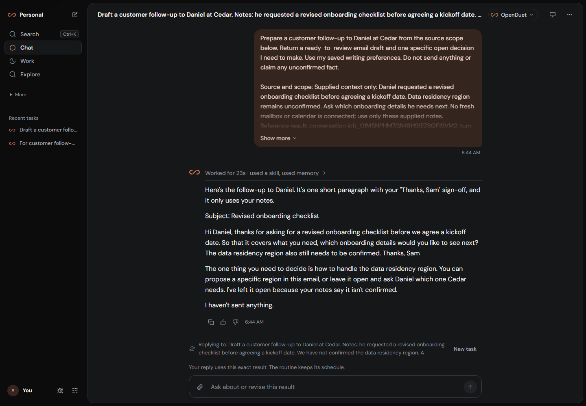
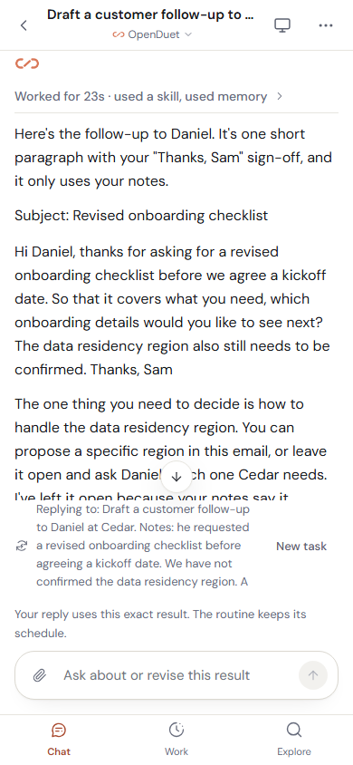

<div align="center">
  
  <h1>OpenDuet</h1>
  <p><strong>Your personal AI. Already on it.</strong></p>
  <p>It remembers your work, learns the routines you teach it, and comes back with results.<br />Run it on your own server with a model you choose.</p>
  <p>
    <a href="https://github.com/ychampion/openduet/actions/workflows/ci.yml"></a>
    <a href="LICENSE"></a>
  </p>
  <p><a href="#get-started">Install OpenDuet</a> · <a href="#put-it-to-work">Workflows</a> · <a href="docs/PERSONAL_ASSISTANT.md">How it works</a> · <a href="docs/media/live-assistant/opus-learning-and-background.mp4">Watch it work</a></p>
</div>

OpenDuet brings tasks, memory, connected accounts and recurring work into one
personal assistant. Give it context, review what it prepares, correct it, and
delegate the work you want it to keep doing. Your server keeps jobs and routines
running when you close the browser.

## Get started

Install OpenDuet once on a computer or server that stays on. Use its web app
from Windows, macOS, Linux or a phone; only the host needs Docker. For access
from other devices, set up [HTTPS](docs/DEPLOYMENT.md#configuration-and-browser-access)
or [Tailscale](docs/DEPLOYMENT.md#tailscale).

For a local installation, open the printed `http://localhost:3101` address in
Chrome or Edge. Safari needs an HTTPS address for sign-in; use
[HTTPS](docs/DEPLOYMENT.md#configuration-and-browser-access) or
[Tailscale](docs/DEPLOYMENT.md#tailscale) when accessing your host from Safari.

### 1. Prepare your host

Use an always-on Linux **x86-64** host, or Docker Desktop with Linux containers
on Windows / Intel Mac. Allow **8 GB RAM and 20 GB free disk**. Install
**Docker Engine 28+**, **Compose 2.33.1+**, and, on Windows, **Git for Windows**.
Published images target `linux/amd64`; see [deployment](docs/DEPLOYMENT.md) for
source-build options and platform details. Apple Silicon Macs can use the web
app hosted on any supported host.

### 2. Install OpenDuet

Linux / Intel Mac, in Bash:

```sh
curl -fsSL https://raw.githubusercontent.com/ychampion/openduet/main/install.sh | bash
```

Windows, in PowerShell:

```powershell
irm https://raw.githubusercontent.com/ychampion/openduet/main/install.ps1 | iex
```

The installer creates `~/openduet`, downloads the public images, starts the
services and prints a one-time account setup link. Open that link and create
your account. The app normally runs at **http://localhost:3101**. This installation
needs no Bun or Node.js; allow several minutes for the first image download.

For Docker setup, alternate ports or troubleshooting, follow the
[step-by-step installation guide](docs/GETTING_STARTED.md).

### 3. Give it a task and connect your model

At **What would you like off your plate?**, enter a task, paste your notes or
attach a supported file, then press Send. Your request is saved while you choose
your provider and model.

Run the compatibility check and look for all three stages: **Credentials
accepted**, **Model responded**, and **Tool use verified**. The check uses your
selected model through Hermes, including a read-only tool call; provider billing
can apply. When it passes, your saved request continues automatically.

Connect the accounts needed for the task in **Settings → Connections**. In
**Settings → Approvals**, choose **Ask me for everything** to review consequential
actions yourself, or select the autonomy policy that suits your work.

### 4. Teach it and delegate the next run

Review the result in **Chat** and reply with a correction. Automatic memory can
carry lasting preferences forward; use **Remember this preference** or **Save
these steps** when you want to review the exact instruction being saved.

Choose **Run this automatically** to review a recurring instruction and schedule.
Keep the host running and return to **Work** for results, progress and questions
that need you. Manage notification preferences separately in Settings, and pause
a routine from **Work → Recurring** whenever you want it to stop.

For phone access, configure [HTTPS or Tailscale](docs/DEPLOYMENT.md), then install
the PWA from your browser. OpenDuet runs in desktop and mobile browsers.

<details>
<summary>Build from source or add a browser worker</summary>

For source development, install Git, Node.js 22+ and Bun 1.3.13, alongside the
Docker prerequisites above:

```sh
git clone https://github.com/ychampion/openduet.git
cd openduet
bun install --frozen-lockfile
bun run openduet init --connect-in-app
docker compose -f deploy/docker-compose.yml up -d --build --wait --wait-timeout 300
```

Open the setup link printed by `init`. Configuration belongs in the app or local
`deploy/.env`, never in Git. See [deployment](docs/DEPLOYMENT.md),
[the optional browser worker](docs/browser-worker.md), and
[architecture](docs/ARCHITECTURE.md).

</details>

## Put it to work

Start with notes you already have, then add connected accounts and tools as the
work needs them.

| You want to… | Give OpenDuet… | Come back to… |
| --- | --- | --- |
| Send a clear client update | Your notes, milestones and open questions | A concise draft ready for your review |
| Be ready for a meeting | The agenda and documents; calendar access for fresh details | A brief, unresolved decisions and questions to ask |
| Stay on top of a customer thread | A connected mailbox, chosen thread and follow-up deadline | A prepared follow-up when the deadline passes without a reply |
| Start the day with priorities | Connected mail and calendar, plus a daily brief schedule | Meetings, unanswered mail and useful next actions |
| Compare suppliers or tools | Source URLs and web tools; a browser worker where needed | A comparison with citations and gaps to resolve |
| Repeat a useful workflow | A reviewed instruction, saved steps and a schedule | Results in Work while your browser is closed |

Find detailed prompts, required connections and expected outputs in
[ten practical workflows](docs/USE_CASES.md).

### Start with one useful task

For example, paste your own client notes with a request like this:

> Priya at Northstar needs a security review before choosing a pilot date.
> SSO is unconfirmed. Prepare a short follow-up asking which security questions
> her team needs answered. Do not promise SSO or send anything.

OpenDuet keeps the request, prepared draft, source context and review controls
in **Chat**. Open a result to inspect or revise it. A prepared draft stays ready
for review; a confirmed send has its own receipt.

The following captures show OpenDuet using Anthropic Opus 5.5 with supplied
customer notes. It learned a correction automatically, used it in a separate
task, and completed a scheduled preparation with both the browser and frontend
server stopped. The same workflow also passed with a Fireworks model.


**[Watch the result and learned preference](docs/media/live-assistant/opus-learning-and-background.mp4)** ·
**[Execution details](docs/LIVE_MODEL_VERIFICATION.md)**

Reply to the result with “Under 120 words, with one clear ask.” Then choose what
should carry forward:

- **Memory:** lasting facts and preferences can be learned from your own words.
  Review, edit or forget them in **Settings → Memory**. Start a message with
  **off the record** to skip learning from it.
- **Skills:** use **Save these steps** to review a reusable personal procedure.
  Your saved context and procedures stay with your installation when you change models.
- **Recurring work:** use **Run this automatically** to confirm the next run,
  or **Work → Recurring → Watch a customer thread** for a specific follow-up.


Customer watches support native Gmail and Microsoft mailboxes. Choose the
mailbox and thread, confirm the customer, deadline and time zone, and review
the follow-up when it returns. New replies, paused watches and revoked access
prevent obsolete work. Sending remains governed by your approval policy.

### Notice the next useful step

OpenDuet checks watched calendar events, unresolved source signals and stalled
personal tasks every minute, even with the browser closed. Chat offers up to
three suggestions with a reason and source.

**Plan together** gathers the current context into an editable request with an
attached source note. Add your judgment and press Send when ready. **Tomorrow**,
**Not useful** and **Pause suggestions** let you shape what deserves attention.

Suggestions gather saved context; delegated jobs, routines and supported watches
perform the background work. Push delivery has its own preferences. See
[always-on collaboration](docs/ALWAYS_ON.md) for behavior and controls.

## Keep the work together

| Place | What you do there |
| --- | --- |
| **Chat** | Hand off a task, continue existing work or reply to a specific result. |
| **Work** | Review **Needs you**, **In progress**, **Finished**, and **Recurring**; pause routines and customer watches. |
| **Explore** | Begin meeting preparation, research, follow-ups, a daily brief or writing in your style, with the inputs each workflow needs. |
| **Settings** | Choose your model and manage connections, memory, skills, approvals and delivery preferences. |

| Desktop in dark appearance | Phone result view |
| --- | --- |
|  |  |

## Why run your own assistant?

Your working context, taught procedures and job history stay in your
installation while you choose a supported model and extend its tools.
Apache-2.0 source lets you inspect and adapt the system. You control uptime,
updates and backups; connected model and tool services receive the data their
requests need.

OpenDuet focuses on owning and adapting your assistant. For a capability-by-capability
look at the managed alternative, see the
[Claude Duet comparison](docs/CLAUDE_DUET_COMPARISON.md). OpenDuet is independent
of Anthropic.

| Use and understand | Build and operate |
| --- | --- |
| [First task guide](docs/GETTING_STARTED.md) | [Contributing](CONTRIBUTING.md) |
| [Personal assistant behavior](docs/PERSONAL_ASSISTANT.md) | [Architecture](docs/ARCHITECTURE.md) |
| [Example workflows](docs/USE_CASES.md) | [Deployment](docs/DEPLOYMENT.md) |
| [Product verification](docs/PRODUCT_VERIFICATION.md) | [Upgrading](docs/UPGRADING.md) |
| [Live model results](docs/LIVE_MODEL_VERIFICATION.md) | [Release readiness](docs/RELEASE_READINESS.md) |

Need help? [Report a problem](https://github.com/ychampion/openduet/issues/new/choose)
with your installation method, version and reproduction steps. For security
reports, use the [private reporting channel](SECURITY.md).

Sharing OpenDuet? The [launch kit](docs/LAUNCH.md) includes a demo walkthrough,
screenshots, recordings and prepared announcement copy.

Preserve [LICENSE](LICENSE), [NOTICE](NOTICE) and [source provenance](docs/PROVENANCE.md)
in redistributions. Run `bun run icons` after editing the logo source.
