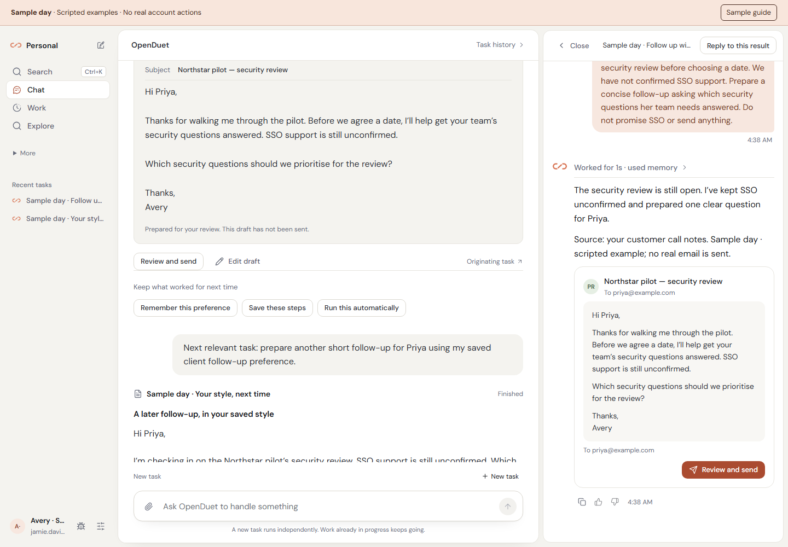

<div align="center">
  
  <h1>OpenDuet</h1>
  <p><strong>Your personal AI. Already on it.</strong></p>
  <p>It remembers your work, learns the routines you teach it, and comes back with results.<br />Run it on your own server with a model you choose.</p>
  <p>
    <a href="https://github.com/ychampion/openduet/actions/workflows/ci.yml"></a>
    <a href="LICENSE"></a>
  </p>
  <p><a href="#try-a-sample-day">Try it</a> · <a href="#get-started">Install</a> · <a href="docs/PERSONAL_ASSISTANT.md">How it works</a> · <a href="docs/PRODUCT_VERIFICATION.md">What we tested</a></p>
</div>

## Try a Sample day

Run a local, clearly labeled walkthrough before connecting a model or account:

```sh
git clone https://github.com/ychampion/openduet.git
cd openduet
bun install --frozen-lockfile
bun run sample
```

Open **http://127.0.0.1:5321**. Requires Git, Node.js 22+ and Bun 1.3.13.
The runner starts fresh, in-memory fixtures on loopback. It removes inherited
installation settings before loading fixtures, disables dotenv loading for the
sample web app, and uses no service credentials, database or real connectors.
Restart it to reset the day.
Every screen says **Sample day · Scripted examples · No real account actions**.
There is no hosted public demo.

[](docs/SHOWCASE.md)

A 21-second browser recording of the scripted local sample. No real mail is sent.

**[Walkthrough, screenshots and recording](docs/SHOWCASE.md)** ·
**[Media provenance](docs/media/sample-day/README.md)**

The sample uses the production React components with deterministic responses.
Its sample send produces a fixture receipt. It is an interaction demo;
[real service, database and Hermes checks](docs/PRODUCT_VERIFICATION.md) are separate.

## One task, then a better next time

Start with a concrete request and the information you already have:

> Priya at Northstar needs a security review before choosing a pilot date.
> SSO is unconfirmed. Prepare a short follow-up asking which security questions
> her team needs answered. Do not promise SSO or send anything.

OpenDuet keeps the request, prepared draft, source context and review controls
in **Chat**. Open a result to inspect or revise it. **Draft prepared** means a
draft exists; a confirmed send has its own receipt.

Then make three separate choices:

1. **Correct the work.** Reply to that result: “Under 120 words, with one clear ask.”
   Replies to an older run keep that run as their source.
2. **Teach it.** Choose **Remember this preference** to review and save the exact
   wording. Or **Save these steps** to review a reusable personal skill.
   Inspect, edit or forget saved context; changing the model keeps it in your installation.
3. **Delegate next time.** Choose **Run this automatically** for an explicit
   schedule. For a customer thread, confirm the mailbox, customer, thread,
   deadline and time zone in **Work → Recurring → Watch a customer thread**.

The customer watch checks fresh thread state and prepares one follow-up when
the deadline arrives without a reply. A reply, pause or loss of access blocks
obsolete work. Sending is a separate reviewed action; a confirmed receipt
completes this one-shot watch. Native Gmail and Microsoft mailboxes support
this watch; IMAP and generic MCP mailboxes are not offered for it.



## Keep the work together

| Place | What you do there |
| --- | --- |
| **Chat** | Give the main assistant a task, continue an actual task, or reply to a specific result. Unrelated tasks retain separate execution and approval boundaries. |
| **Work** | Review **Needs you**, **In progress**, **Finished**, and **Recurring**. Pause the actual routine or customer watch. |
| **Explore** | Start meeting preparation, research, follow-ups, a daily brief, or writing in your style. Each preset explains its inputs and prerequisites. |
| **Settings** | Choose a model; manage accounts, memory, skills, approvals and delivery preferences. Advanced tools remain available. |

| Desktop in dark appearance | Phone result view |
| --- | --- |
|  |  |

Notes or a supported file are enough to begin. Connect a calendar, mailbox or
research tool when a task needs fresh information. Output quality depends on
the selected model and available tools. See [five useful starting workflows](docs/USE_CASES.md).

## Get started

### 1. Prepare your host

Use an always-on Linux **x86-64** host, or Docker Desktop with Linux containers
on Windows / Intel Mac. Allow **8 GB RAM and 20 GB free disk**. Published images
target `linux/amd64`; ARM source builds need separate validation.
Install **Docker Engine 28+**, **Compose 2.33.1+**, and, on Windows, Git for Windows.

### 2. Install

Linux / macOS, in Bash:

```sh
curl -fsSL https://raw.githubusercontent.com/ychampion/openduet/main/install.sh | bash
```

Windows, in PowerShell:

```powershell
irm https://raw.githubusercontent.com/ychampion/openduet/main/install.ps1 | iex
```

The installer creates `~/openduet`, downloads public images, starts the stack
and prints a one-time account setup link. Open it and create your account.
The image installation needs no Bun or Node.js. The first download can take
several minutes. Read [the detailed guide and troubleshooting](docs/GETTING_STARTED.md).

### 3. Hand off a real task

At **What would you like off your plate?**, enter your actual task, paste notes
or attach a supported file. Send saves the exact request before model setup.
Choose your provider and model, then run the compatibility check. It separately
shows **Credentials accepted**, **Model responded**, and **Tool use verified**.
Listing models alone does not pass the check. A successful check resumes the
saved request once; refresh/retry retains its submission key.

The compatibility check uses the selected model through Hermes with an
isolated read-only note tool. It may use paid inference: up to three model
requests and 1,536 output tokens, with a 45-second runtime limit. It cannot
verify task quality. Practice responses are not accepted for real handoffs.

Connect only the accounts needed for your next task. In **Settings → Approvals**,
choose **Ask me for everything** if you want a fresh review before consequential
actions. Other autonomy settings can allow actions under existing policy.

### 4. Return to useful work

Keep your host running for jobs and routines. **Work** shows results and
questions that need you. Delivery preferences separately control decisions,
your requested work, requested reminders, the daily brief and unsolicited
suggestions. Suggestions start off. Editing the daily brief changes its real
schedule; pausing a routine stops its trigger.

For phone access, configure [HTTPS or Tailscale](docs/DEPLOYMENT.md) and install
the PWA from your browser. There are no native mobile binaries.

<details>
<summary>Build the real service from source / add a browser worker</summary>

```sh
bun run openduet init --connect-in-app
docker compose -f deploy/docker-compose.yml up -d --build --wait --wait-timeout 300
```

Run these inside the cloned repository after installing dependencies. Open the
setup link printed by `init`. Configuration belongs in the app or local
`deploy/.env`, never in Git. See [deployment](docs/DEPLOYMENT.md),
[optional browser worker](docs/browser-worker.md), and [architecture](docs/ARCHITECTURE.md).

</details>

## Why run your own assistant?

Your working context, taught procedures and job history stay in your
installation while you choose a supported model and extend the tools.
Apache-2.0 source lets you inspect and adapt the system. You operate uptime,
updates and backups; connected model/tool services receive the data their
requests need. Self-hosting does not make remote inference local.

Claude Duet offers a managed experience. OpenDuet focuses on owning and adapting
your assistant. See the [source-backed feature comparison](docs/CLAUDE_DUET_COMPARISON.md)
for native mobile, wallet and connector gaps. We have not benchmarked task quality
against a Duet account. OpenDuet is independent of Anthropic.

| Use and understand | Build and operate |
| --- | --- |
| [First task guide](docs/GETTING_STARTED.md) | [Contributing and tests](CONTRIBUTING.md) |
| [Personal assistant behavior](docs/PERSONAL_ASSISTANT.md) | [Architecture](docs/ARCHITECTURE.md) |
| [Screenshots and walkthrough](docs/SHOWCASE.md) | [Deployment](docs/DEPLOYMENT.md) |
| [Product verification and limits](docs/PRODUCT_VERIFICATION.md) | [Upgrading](docs/UPGRADING.md) |

Preserve [LICENSE](LICENSE), [NOTICE](NOTICE) and [source provenance](docs/PROVENANCE.md)
in redistributions. Run `bun run icons` after editing the logo source.
