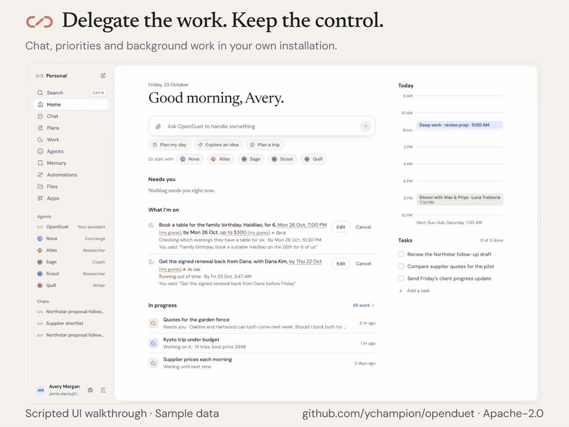
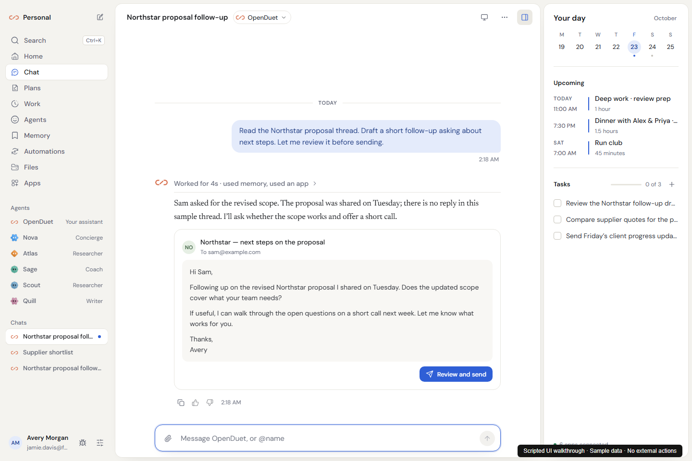

<div align="center">
  
  <h1>OpenDuet</h1>
  <p><strong>Delegate the work. Keep the control.</strong></p>
  <p>An open-source, always-on assistant on your own server.<br />Your models. Your workflows. Your memory.</p>
  <p>
    <a href="https://github.com/ychampion/openduet/actions/workflows/ci.yml"></a>
    <a href="LICENSE"></a>
    <a href="https://github.com/ychampion/openduet/releases"></a>
  </p>
  <p><a href="#get-started">Install</a> · <a href="docs/SHOWCASE.md">Watch the walkthroughs</a> · <a href="docs/USE_CASES.md">Try a workflow</a> · <a href="docs/CLAUDE_DUET_COMPARISON.md">Compare with Claude Duet</a></p>
</div>

Give OpenDuet a task, close your laptop, and come back to the result and the
decisions that need you. It brings chat, background jobs, scheduled routines,
inspectable memory and connected tools into one self-hosted application.

[](https://github.com/ychampion/openduet/releases/download/v0.2.1/openduet-overview.mp4)

**[Watch the overview](https://github.com/ychampion/openduet/releases/download/v0.2.1/openduet-overview.mp4)** ·
**[Follow-up walkthrough](https://github.com/ychampion/openduet/releases/download/v0.2.1/openduet-follow-up.mp4)** ·
**[Routines walkthrough](https://github.com/ychampion/openduet/releases/download/v0.2.1/openduet-routines.mp4)**

*The showcase uses the real web UI with scripted responses and sample accounts.
It demonstrates the interaction, including review before sending; no real mail
is sent. See [media provenance](docs/media/README.md) and the separate
[production release checks](docs/RELEASE_READINESS.md). Videos have on-screen
captions and no audio.*

## Why choose OpenDuet?

OpenDuet is for people who want to operate and extend their own assistant.

| What you want | What OpenDuet gives you |
| --- | --- |
| Choose the model for the job | Configure your own provider or a compatible local endpoint. Change providers without moving to a different assistant. |
| Own the installation | Run the service, database and job history on your infrastructure. Apache-2.0 source you can inspect, modify and redistribute. |
| Make work repeatable | Turn a useful instruction into a scheduled routine. Inspect its runs, pause it or change the workflow. |
| Review consequential actions | Set **Approvals → Ask me for everything**, then review the destination and action before authorising it. Keep receipts of what happened. |
| Keep useful context editable | Inspect, correct, export or forget memories; manage reusable skills. |
| Add your own tools | Connect mail, calendars, files and MCP servers, with optional browser, sandbox and device workers. |
| Start without a product waitlist | Install the source or public images directly. No Claude subscription is required. Model inference and optional services have their own costs. |

You operate uptime, updates and backups. Connected model and tool providers
still receive the data needed for their requests; self-hosting alone does not
make those requests local. Start with one workflow and the minimum connections
it needs.

## Work you can hand off

| Workflow | Ask OpenDuet | What you review |
| --- | --- | --- |
| **Start the day prepared** | “At 8 AM, brief me on meetings, urgent mail and my top three priorities.” | A concise brief, source links and open questions. |
| **Follow up with clients** | “Read the Northstar proposal thread. Draft a short follow-up. Let me review it before sending.” | The recipient, subject and complete draft. |
| **Research a decision** | “Compare these three suppliers. Link sources, separate facts from assumptions and list missing information.” | A comparison, recommendation and questions to verify. |
| **Turn files into an update** | “Use these CSVs to prepare a weekly summary. Show calculations and flag missing data.” | A report and reproducible files, with the configured computer tools. |
| **Keep recurring work moving** | “Every Friday, review the supplier shortlist and report only meaningful changes.” | A run history with results, changes and failures. |
| **Build reusable context** | “Remember how I write client updates: short, specific, with the next action first.” | A memory you can inspect, correct or forget. |

These are starting instructions, not guaranteed outcomes across models and
integrations. The [use-case playbook](docs/USE_CASES.md) includes ten workflows,
copyable prompts, prerequisites and a definition of done for each.

## See the app

### Read the thread. Review the draft. Decide what leaves.



### Give recurring work a schedule


<details>
<summary>Memory, models, dark mode and phone layouts</summary>

| Inspect what it remembers | Choose your model |
| --- | --- |
|  |  |

| Dark appearance | On your phone |
| --- | --- |
|  |  |

</details>

The phone experience is a responsive web app and installable PWA. See the
[full gallery and walkthrough transcripts](docs/SHOWCASE.md).

## Get started

### 1. Prepare your host

Use a Linux **x86-64** host, or Docker Desktop with Linux containers on Windows
or an Intel Mac. Published images currently target `linux/amd64`; Apple Silicon
and other ARM hosts require an appropriate source build and are not covered by
the published-image install check. Allow **8 GB RAM and 20 GB free disk**.

You need **Docker Engine 28+** and **Docker Compose 2.33.1+**. Start Docker first.
Windows also needs [Git for Windows](https://git-scm.com/download/win).

### 2. Install

**Linux / macOS — Bash**

```sh
curl -fsSL https://raw.githubusercontent.com/ychampion/openduet/main/install.sh | bash
```

**Windows — PowerShell**

```powershell
irm https://raw.githubusercontent.com/ychampion/openduet/main/install.ps1 | iex
```

The installer downloads public images, creates `~/openduet`, starts the stack
and prints your one-time account setup link. The first download can take
several minutes. Open that link and create your account. No Bun or Node.js is
needed for this image-based installation.

### 3. Connect a real model

Open **Settings → Models**, configure your provider, API key and model, and
save. The initial practice model demonstrates the interface; connect a real
model to do real work. Then connect the specific accounts your workflow needs
in **Settings → Connections**.

For approval before every change, choose **Settings → Approvals → Ask me for
everything**. Other autonomy levels and auto-review can allow actions without
a new approval.

### 4. Complete your first task

Open [localhost:3101](http://localhost:3101) and try a task with no external
connections:

> Turn these notes into a client update: landing page copy is approved;
> mobile screenshots are due Friday; launch is Monday. Give me a status,
> risks and next actions. Ask if a date is ambiguous. Do not send anything.

Check the result, then try a [connected workflow](docs/USE_CASES.md). Your host
must stay on for background work. For access from another device, configure
HTTPS or Tailscale before adding OpenDuet to your phone’s home screen.

**[Detailed first-run guide and troubleshooting →](docs/GETTING_STARTED.md)**

<details>
<summary>Optional browser worker and source installation</summary>

Once your account exists, enable the agent’s browser without installing Bun:

```sh
curl -fsSL https://raw.githubusercontent.com/ychampion/openduet/main/install.sh | OPENDUET_BROWSER=1 bash
```

To develop or build images yourself, install Git, Bun **1.3.13**, Docker and
Compose, then:

```sh
git clone https://github.com/ychampion/openduet.git
cd openduet
bun install --frozen-lockfile
bun run openduet init --connect-in-app
docker compose -f deploy/docker-compose.yml up -d --build --wait --wait-timeout 300
```

Open the setup link printed by `init`. Keys belong in the app or your local
`deploy/.env`, never in Git. See [deployment](docs/DEPLOYMENT.md),
[browser setup](docs/browser-worker.md), and [capabilities](docs/CAPABILITIES.md).

</details>

## OpenDuet and Claude Duet

Claude Duet’s published preview combines a managed cloud computer, native mobile
apps and Anthropic’s model. OpenDuet offers a self-hosted service with model
choice, editable memory and extensible workflows. Choose OpenDuet when owning
and adapting the installation matters to you.

| Area | OpenDuet | Claude Duet’s published preview |
| --- | --- | --- |
| Hosting | Your server; you operate it | Anthropic-managed cloud |
| Model | Your configured provider / compatible local endpoint | Opus 5.5 |
| Source | Apache-2.0 | Proprietary |
| Background work and briefs | Durable jobs, routines, watches | Cloud work, periodic checks and briefs |
| Mobile | Responsive web / installable PWA | Native iOS and Android, plus web |
| Tools | Native connectors, MCP, optional connector services | Marketplace advertises 6,000+ connectors |
| Wallet integrations | No built-in equivalent | Link and Shop Pay |

Comparison checked October 22, 2026 against Anthropic’s
[announcement](https://claude.com/resources/articles/claude-duet) and
[product page](https://claude.com/product/claude-duet). We have not run a task
quality benchmark against a Duet account. See the
[complete comparison and evidence](docs/CLAUDE_DUET_COMPARISON.md).
OpenDuet is independent and is not affiliated with Anthropic.

## Built to inspect

The service, Postgres job queue, React app, Hermes runtime, connectors and
optional workers are one application. Test evidence covers durable execution,
approval policy, receipts, memory boundaries, browser behaviour and installation.
The [release report](docs/RELEASE_READINESS.md) records what ran and its limits;
the [capability matrix](docs/CAPABILITIES.md) links features to their tests.

| Learn | Build and operate |
| --- | --- |
| [First-run guide](docs/GETTING_STARTED.md) | [Contributing and tests](CONTRIBUTING.md) |
| [Use-case playbook](docs/USE_CASES.md) | [Architecture](docs/ARCHITECTURE.md) |
| [Screenshots and videos](docs/SHOWCASE.md) | [Deployment](docs/DEPLOYMENT.md) |
| [Feature comparison](docs/CLAUDE_DUET_COMPARISON.md) | [Upgrading](docs/UPGRADING.md) |
| [Setup with a coding assistant](SETUP-WITH-AN-AGENT.md) | [Security policy](SECURITY.md) |

For a scripted UI development preview, run `bun run dev:mock` and
`bun run dev:web` in separate terminals. This is a fixture preview, not a
replacement for the installed service. Run `bun run icons` after editing the
logo source.

Apache-2.0. Preserve [LICENSE](LICENSE), [NOTICE](NOTICE) and
[source provenance](docs/PROVENANCE.md) in redistributions.
