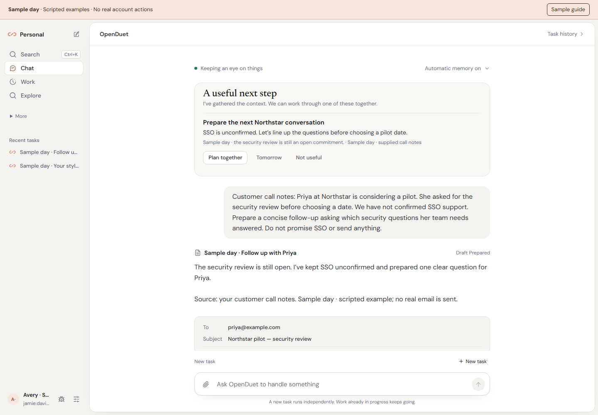
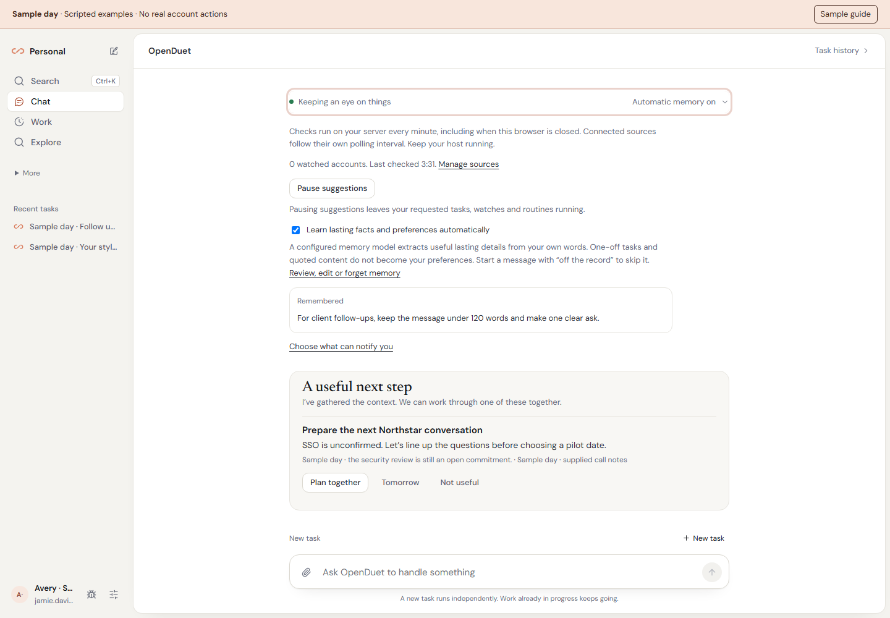
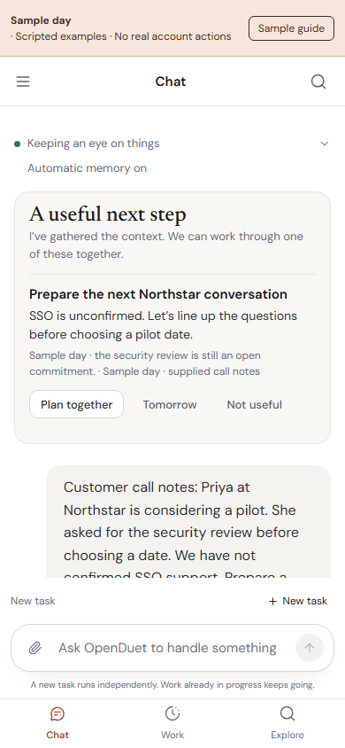

# Always-on collaboration

OpenDuet keeps working on its host when you close the browser. Keep the host and
worker services running; a sleeping laptop cannot poll accounts or run routines.

## What it notices

The assistant pulse runs on the server every minute. It reads current saved
source state and prepares at most three suggestions in your personal Chat:

| Evidence | Suggested collaboration |
| --- | --- |
| Watched calendar meeting within 24 hours | Prepare together with the title, time and available location. Cancelled and declined events are excluded; the calendar must have a successful read within 30 minutes. |
| An unresolved needs-you source signal or open situation | Work through the question or change with its recorded reason and evidence. A newer source verdict supersedes older advice. |
| A personal task failed or waiting for input for 30 minutes to 7 days | Find a way forward, with its request and latest saved answer as context. Plan together targets that existing task. |

Source polling follows the connection's own cadence; the one-minute pulse does
not increase provider polling or run continuous model inference. Without useful
evidence, no suggestion is fabricated. Shared spaces do not receive this personal
feed. A replica without the worker lease does not scan.

The heartbeat is persisted. Chat distinguishes starting, watching, delayed,
paused and unavailable states. A check more than three minutes old is shown as
delayed. A failed refresh hides stale advice and the healthy indicator; Retry
restores current suggestions without changing an unsent request. The pulse
does not spend model tokens, submit a job or perform an external action.

## Plan together

Each suggestion explains its source and reason. **Plan together** rechecks current
eligibility and creates a scoped text attachment from the current saved evidence.
The request is editable and stays unsent through refresh. Existing input, files
and a selected task are preserved. Stalled-task suggestions continue their exact
task; other suggestions begin independent work when you choose Send.

Outside source text remains in the attachment as context, rather than being
inserted into the person's prompt as instructions. The agent must recheck live
sources before consequential actions; a prepared note grants no new permission.
This feature gathers context, rather than autonomously researching every suggestion.

**Tomorrow** hides the suggestion for 24 hours. **Not useful** dismisses that
source suggestion. These choices survive repeated checks and restart. Completing
the task, cancelling a meeting, revoking a connection or disabling its watch
removes ineligible advice immediately on the next read. Stored suggestion rows
contain source references, not copied mail or calendar bodies. Removing a space
clears its pulse and suggestion records.

**Pause suggestions** stops this personal noticing loop. Already delegated tasks,
scheduled routines and customer watches continue under their existing controls.
These new context suggestions appear in Chat. Existing task, watch and routine
notifications keep their delivery settings; this change does not enable push.

## Learning automatically

Automatic capture already runs in OpenDuet's existing memory service. Chat now
exposes its setting and recent saved details. A configured memory model extracts
lasting facts and preferences from the person's own words; it is asynchronous,
subject to privacy policy and spending limits, and model-dependent. One-off tasks,
quoted material and assistant guesses are not standing preferences.

Start a message with **off the record** to skip capture from it. Review, edit and
forget details in **Settings → Memory**. Corrections supersede the previous value;
forgotten details are excluded from current recall. Explicit preference and
procedure controls are still available. The setting label does not claim every
message produced a saved memory or prove every model follows its recall.

## Try it and inspect the evidence

Run `bun run sample` and open http://127.0.0.1:5321. The visibly labeled fictional
Northstar example offers a suggested next step, attached context, memory controls
and an editable request. It performs no paid inference or real account action.

[Watch Plan together, editing and refresh restoration](media/sample-day/proactive.mp4).

| Learning controls | Phone |
| --- | --- |
|  |  |

Verification uses disposable data and scripted models:

- `assistant-pulse.test.ts`: server scans without a browser, restart deduplication,
  pause/snooze/dismiss, old heartbeat, task completion, source cancellation,
  disconnect, stale calendar, private-space boundaries, actual context attachment,
  no job/action submission, concurrent pause, replica lease and superseded triage.
- Existing memory extraction, forgetting and settings tests: corrected values,
  deduplication, provenance, separation of people and scope, and removal from recall.
- `check-assistant.py`: desktop/phone light and dark appearance, 320-pixel layout,
  keyboard controls, preserved input, unsent request/file restoration, pause,
  memory toggle, snooze and dismissal. UI settings persistence is simulated per
  browser context; production database behavior is tested separately above.
- Runtime instruction tests retain the existing identity and context-budget caps.

The focused October 24 checks passed: **8 assistant integration tests**, **106
runtime instruction/skills tests**, **254 runtime-plugin tests** (7 skipped),
**3 generated-client sync tests**, **649 frontend tests**, and **45 browser
checks** with zero task submissions or page errors. Browser coverage includes a
delayed status read arriving after a
successful pause, blocked browser storage, exact stalled-task continuation, and
server failure and recovery after an earlier healthy check.
First-handoff and source-recovery browser proofs also passed, with 11 and 5 checks
respectively. Typecheck, lint, deployment configuration checks and the production
web build also passed.

The full Linux run on the implementation snapshot completed with **9,913 passed,
71 skipped, 2 todo and 2 failures**. It caught a generated migration journal
timestamp that needed the repository's sequential value; an unchanged browser
file-chooser test also failed once. The journal was corrected, and the final
combined Linux rerun of assistant, journal, browser-worker and frontend tests
passed **670 tests, with zero failures**. Published-commit results are available
in [CI](https://github.com/ychampion/openduet/actions/workflows/ci.yml).

The [earlier product verification](PRODUCT_VERIFICATION.md) records the previous
delivery separately. These checks do not establish live provider reliability,
autonomous research quality or a benchmark against Claude Duet.
