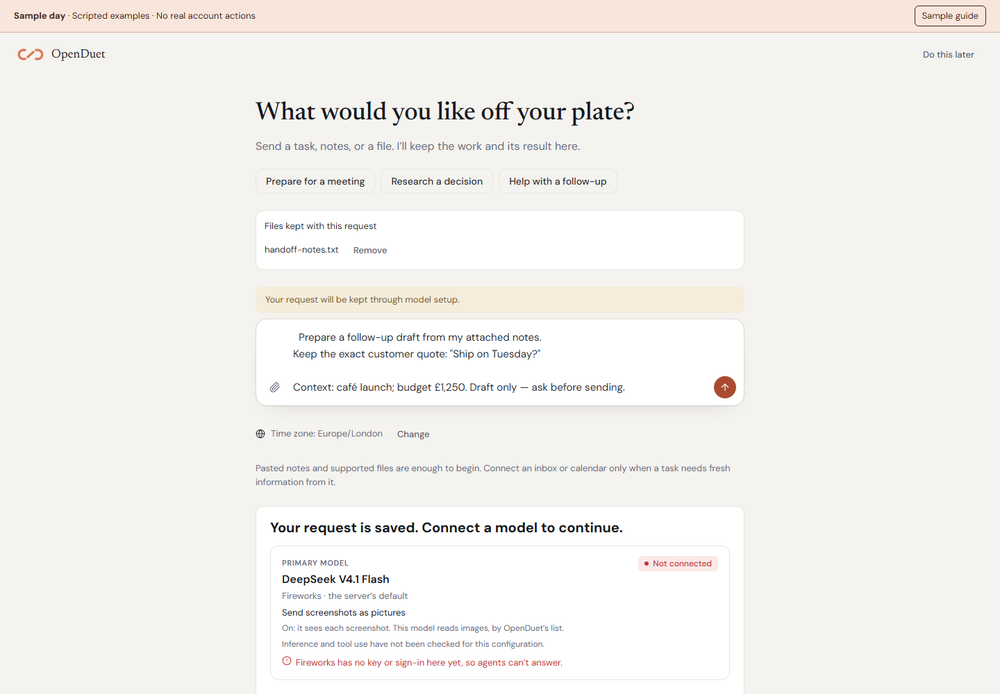

# Your first useful task in OpenDuet

Go from a fresh installation to one completed task, then a connected workflow.
For all operator options, use [DEPLOYMENT.md](DEPLOYMENT.md).

## Before you start

You need a host that can stay on, Docker Engine **28+**, Compose **2.33.1+**,
**8 GB RAM**, **20 GB free disk**, and outbound access to GitHub and your model
provider. Published images are **linux/amd64**. Use Linux x86-64 or Docker
Desktop with Linux containers on Windows / Intel Mac. ARM source builds are
not covered by the public-image install checks. Windows also needs Git for
Windows. The clean-machine installer check runs on Linux.

Check Docker in your terminal:

```sh
docker version
docker compose version
docker info --format '{{.OSType}} / {{.Architecture}}'
```

Expected: the server is reachable, Compose meets the minimum version, and the
engine reports Linux. Start Docker Desktop if the server cannot be reached.
Use the [Docker installation guide](https://docs.docker.com/get-started/get-docker/)
if Docker is missing.

## 1. Install the public images

Linux / macOS, in Bash:

```sh
curl -fsSL https://raw.githubusercontent.com/ychampion/openduet/main/install.sh | bash
```

Windows, in PowerShell:

```powershell
irm https://raw.githubusercontent.com/ychampion/openduet/main/install.ps1 | iex
```

The installer creates `~/openduet` and local configuration, pulls the images
and starts the services. It prints the web address and a one-time setup link.
Keep the setup code until you have created your account; it expires after
72 hours. On the host, the app is normally at **http://localhost:3101**.

Prefer to inspect the installer first? Download [install.sh](../install.sh)
or [install.ps1](../install.ps1), read it, then run the saved file. For another
directory, project name or ports, see the [deployment guide](DEPLOYMENT.md).

## 2. Give it a real task

Open the setup link and create your account. The next screen asks **What would
you like off your plate?** Choose a starter or enter your own task, then paste
notes or attach a supported file. Time zone is detected automatically; use
**Change** if it is wrong. No personal questionnaire is required.

Try this request with notes you can check:

```text
Priya at Northstar needs a security review before choosing a pilot date.
We have not confirmed SSO support. Prepare a short follow-up asking which
security questions her team needs answered. Do not promise SSO or send anything.
```

Pasted context is enough for this draft. You can connect an inbox later.

## 3. Connect and verify the model

Press Send. If a model is missing or unchecked, your exact text and uploaded
attachment references are kept while setup opens. Configure the provider and
selected model, then review the three separate check stages:



| Stage | What it proves |
| --- | --- |
| Credentials accepted | The provider accepted the configured credentials. Listing models alone proves no inference capability. |
| Model responded | The exact selected model produced an inference response through the gateway and Hermes. |
| Tool use verified | That model called the isolated read-only note tool and returned its actual value. |

The check uses up to three model requests, 1,536 output tokens and 45 seconds
of runtime. Provider billing can apply. It has no access to your actual accounts.
IDs and custom endpoints are under Advanced. Changing relevant model configuration
invalidates earlier readiness. A failed check shows its stage and reason; fix
credentials, billing, endpoint, model ID or tool compatibility before retrying.
There is no automatic fallback to another model or the practice fixture.

After a successful check, the saved request continues once. Refreshes or retries
reuse its submission key. Do not retype it into another task to recover a lost
response. The check verifies compatibility, not the quality of every future answer.

In **Settings → Approvals**, choose **Ask me for everything** while learning the
system. Other autonomy settings can permit actions under existing policy.

## 4. Inspect, correct and teach

Your task and its useful output appear in **Chat**. Open the result to see the
source context and full draft. A draft has not been sent. Correct it with
**Reply to this result**, for example “Under 120 words, with one clear ask.”

Use **Remember this preference** to review and explicitly save the exact style
instruction. Use **Save these steps** for a reusable personal procedure. Both
have review fields; neither starts a routine. Inspect or forget memory in
**Settings → Memory**, and manage procedures in **Explore → Skills**.


## 5. Delegate a future responsibility explicitly

For report-only scheduled work, choose **Run this automatically** after a result
and review the instruction and schedule. For a daily brief, use the dedicated
brief settings so there is one actual daily schedule.

For a customer follow-up, connect a native Gmail or Microsoft mailbox in
**Settings → Connections**. Operator OAuth/app setup can be required; see
[CONNECTORS.md](CONNECTORS.md). Open **Work → Recurring → Watch a customer thread**,
select the actual mailbox and thread, inspect its contents, and confirm the
customer email, deadline and time zone. IMAP and generic MCP sources are not
currently offered for this watch.

If no reply arrives by the confirmed time, a draft returns for review. A fresh
reply, paused watch or revoked account access prevents obsolete preparation and
send. Review the exact message before authorizing its send; a receipt completes
the one-shot watch. Use Pause watch to stop its actual future checks.

Your host must stay on. Closing a browser does not stop its server, but turning
off the host does. Budgets, failed checks and disconnected accounts are shown
rather than treated as successful work. See the [complete behavior guide](PERSONAL_ASSISTANT.md).

## Add a browser or phone access

Once your account exists, enable the browser worker from Bash:

```sh
curl -fsSL https://raw.githubusercontent.com/ychampion/openduet/main/install.sh | OPENDUET_BROWSER=1 bash
```

See [browser-worker.md](browser-worker.md) for Windows and source-install
alternatives. Browser access and a sandbox computer are separate capabilities.

For another device, follow the [HTTPS / Tailscale instructions](DEPLOYMENT.md).
Then open your server’s HTTPS address on the phone and use **Add to Home Screen**
or **Install app**. `localhost` on your phone means the phone itself, not your
server. PWA installation and push depend on browser support and a secure
origin. There are no native iOS or Android binaries in this release.

## When something does not work

| Symptom | Check |
| --- | --- |
| Docker cannot be reached | Start the daemon / Docker Desktop and check this account has access. |
| Unsupported engine / Compose | Update to Engine 28+ and Compose 2.33.1+. Use Linux containers. |
| No matching image manifest | Public images target linux/amd64. Check the host architecture. |
| The first download is slow | Allow the pull to finish; check network access and free Docker disk space. |
| The app is not reachable | Use the printed URL. Inspect Compose status and logs below. |
| Setup code is rejected | Check expiry and whether the first account exists. Follow account recovery in the deployment guide. |
| Request stays in setup | Check the selected model’s credentials, inference and tool results. Fix the stated failure, then retry the saved request. |
| A tool is unavailable | Check the connection, credentials, agent access and any required worker. |
| A task's source needs reconnecting | Use **Connect**, or **Provide context** to add notes/files to that exact task. The separate unsent request is preserved. Fresh reads and sending still need the source. |
| A routine fires at the wrong time | Confirm the profile time zone and schedule; inspect its latest run. |
| No proactive suggestions | Open the Chat status row and confirm suggestions are enabled. Connect a watched source, or check whether a personal task meets the [noticing conditions](ALWAYS_ON.md). No evidence means no invented task. |
| Background checks are delayed | Keep the host and worker services running. Closing a browser is fine; suspending the host stops its workers. Inspect service status and logs below. |
| Automatic memory has no new details | Check capture is enabled, the memory model is configured and privacy/spending policy permits extraction. Lasting details are learned asynchronously; review actual saved items in Memory. |
| Phone cannot connect | Use the server’s HTTPS / tailnet address, not localhost. |

For the default installation, in Bash:

```sh
docker compose -f ~/openduet/deploy/docker-compose.yml ps
docker compose -f ~/openduet/deploy/docker-compose.yml logs --tail=100 openduet web
curl -fsS http://localhost:3101/api/health
```

In PowerShell:

```powershell
docker compose -f "$HOME/openduet/deploy/docker-compose.yml" ps
docker compose -f "$HOME/openduet/deploy/docker-compose.yml" logs --tail=100 openduet web
Invoke-RestMethod http://localhost:3101/api/health
```

The health endpoint should return a successful response. Remove account and
task details from logs before posting an issue. Substitute your custom
installation directory if you chose one.

## Keep the installation useful

Back up before updating. Running the installer again updates downloaded files
and images while keeping `deploy/.env`, configuration and volumes; it is not
a backup. See [deployment operations](DEPLOYMENT.md),
[upgrading and rollback](UPGRADING.md) and the
[CLI backup/restore commands](../packages/cli/src/main.ts).

Try another [workflow from the playbook](USE_CASES.md), or inspect the
[feature comparison](CLAUDE_DUET_COMPARISON.md) before choosing work to delegate.
