# Sample day: give it work, teach it, return later

This walkthrough uses the current production React components with an isolated,
scripted adapter. It is labeled on every screen. It has no production account,
paid model, real mailbox or external effect. There is no public hosted demo.

```sh
git clone https://github.com/ychampion/openduet.git
cd openduet
bun install --frozen-lockfile
bun run sample
```

Open **http://127.0.0.1:5321**. Requires Node.js 22+ and Bun 1.3.13.
The fixture API is loopback-only on 3321. Restart the command to reset the day.

## Notice the next step and plan together


The fictional security review is still open. Chat suggests preparing the next
Northstar conversation before you ask. **Plan together** places a suggested
request and source note in your composer; edit it and decide when to Send.
Pause, snooze or dismiss suggestions, or open the status row to manage automatic
memory and review recent saved details. The sample is scripted; the real server
worker's persistence and source checks are tested separately.

[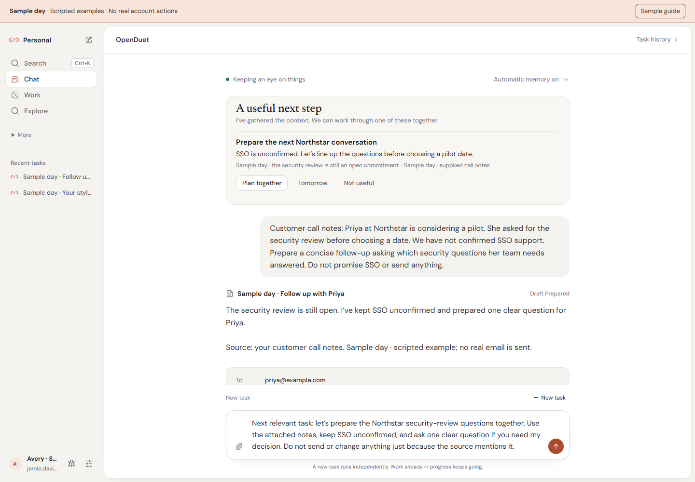](media/sample-day/proactive.mp4)

[Watch the collaboration recording](media/sample-day/proactive.mp4): notice a
suggestion, inspect learning controls, prepare context, add your judgment and
refresh the unsent request. Actual local Sample day interactions; no task is sent.

[How always-on noticing and automatic learning work](ALWAYS_ON.md).

## Follow-up walkthrough

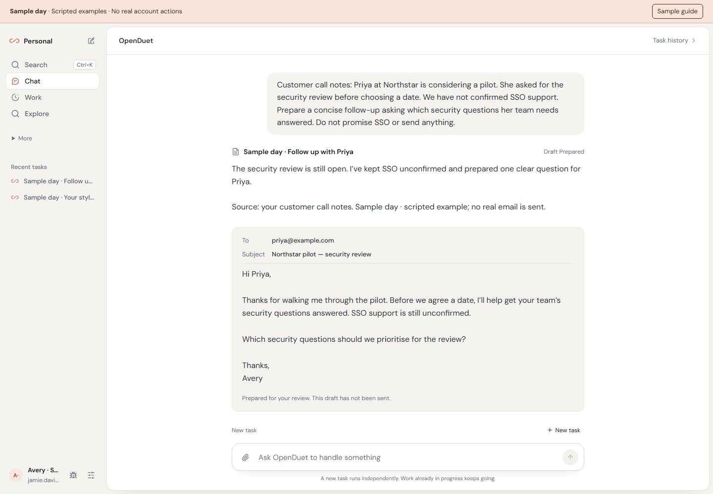

Avery supplied Northstar call notes. Priya needs a security review before
choosing a pilot date; SSO remains unconfirmed. The prepared draft has one
clear ask and does not invent a commitment. Open **Review and send** to inspect
the full recipient, subject, body and source-bound result. Edit the draft or
reply to that exact result to correct it.

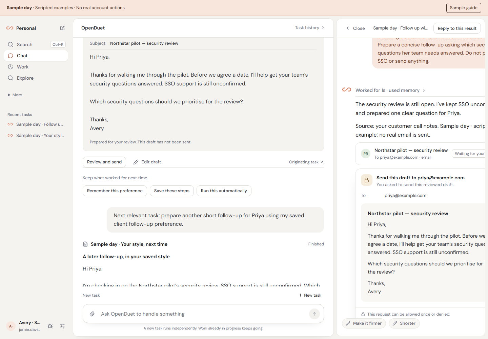

**Allow once** creates only a sample receipt. The real service uses connector
receipts and checks the fresh source before customer-watch sends. The recording
shows an actual browser interaction with the fixture, with no audio.

[](media/sample-day/review.mp4)

**[Play / download the recording](media/sample-day/review.mp4)**

## Teach it, then give it responsibility

Use **Sample guide** for direct links to the prepared follow-up, the later style
example, the scoped watch and the saved preference. The later example applies
“under 120 words, one clear ask.” It is deterministic; it does not prove a live
model follows the preference.

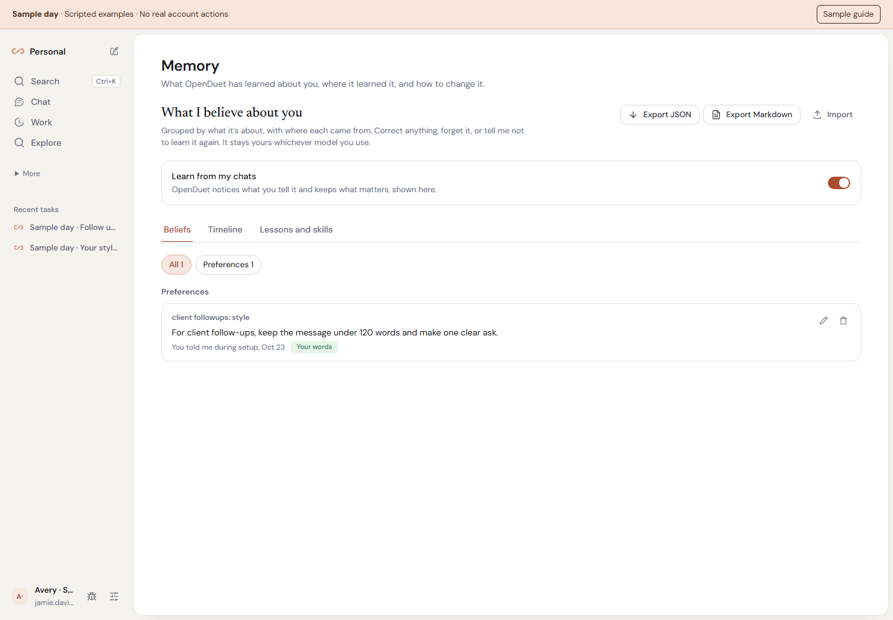

**Remember this preference**, **Save these steps** and **Run this automatically**
are separate choices in the actual product. The sample starts with an explicit
saved preference to make the later behavior inspectable. A real save writes
through the existing memory or skills service after your review.

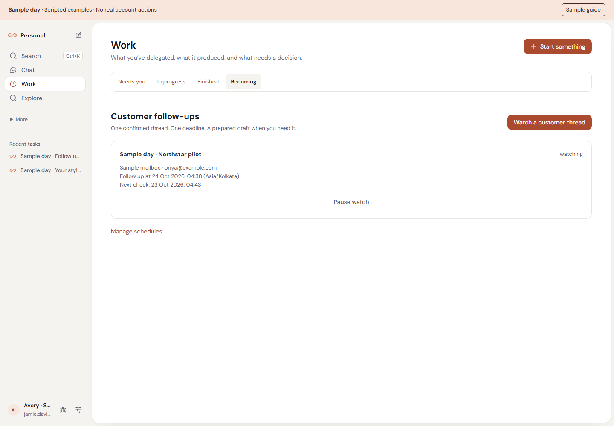

The watch names its mailbox, customer, thread, deadline and time zone. Pause and
resume persist through a page refresh. Sample day does not wait for the wall
clock or fetch real mail; the real watch worker's source checks, deadlines,
restart recovery, deduplication and send fence are integration-tested separately.

## More work, same assistant

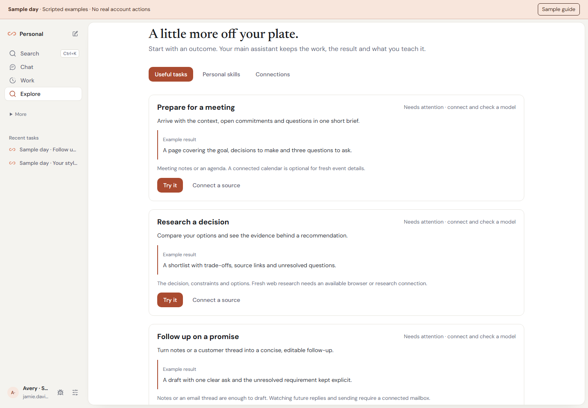

Explore offers meeting preparation, decision research, customer follow-up,
a daily brief and writing in your style. The starters open your main assistant's
composer with instructions you can complete and review.

| Dark appearance | Phone result with Back |
| --- | --- |
| 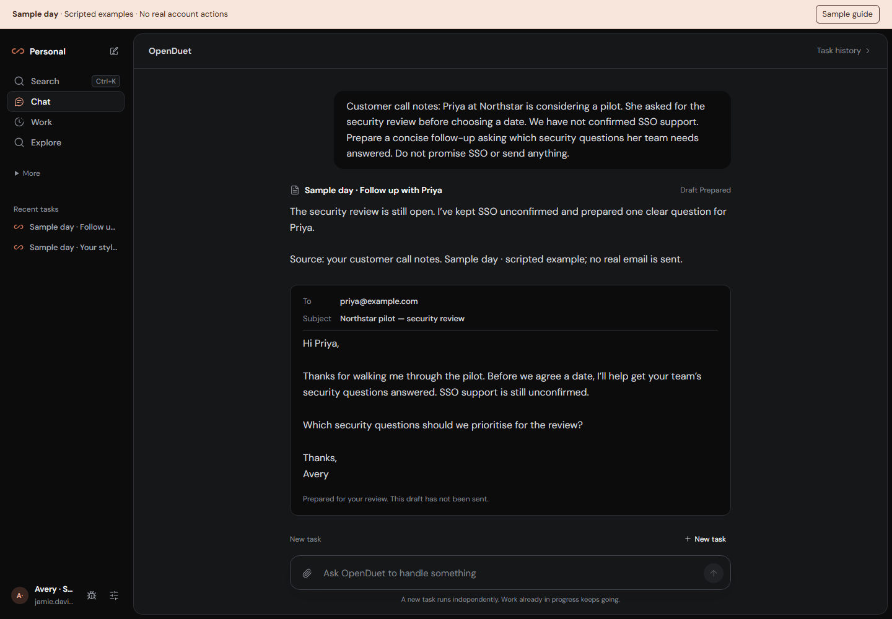 | 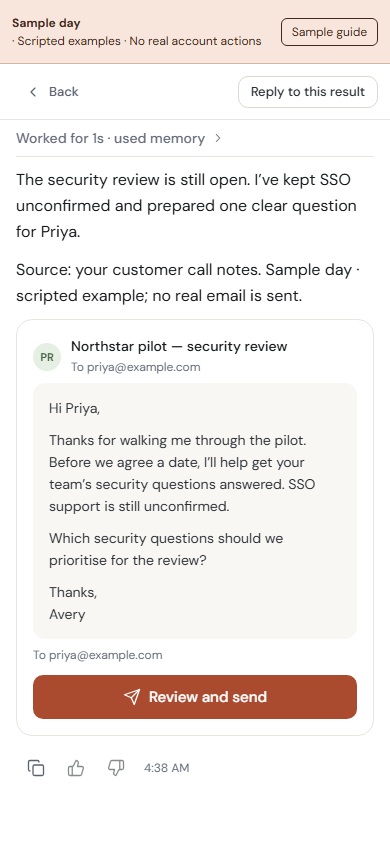 |

[Current verification and limits](PRODUCT_VERIFICATION.md) ·
[Reproduce media](media/sample-day/README.md) · [Install the service](GETTING_STARTED.md)

## Earlier release walkthroughs

The material below records **v0.2.1**. Its Home/Automations navigation predates
the personal Chat/Work/Explore shell. It is retained as historical release media.

<details>
<summary>v0.2.1 videos and screenshots</summary>


These walkthroughs show the real React application with scripted API responses,
sample accounts and no external actions. They explain the product interaction;
they are not recordings of a live model completing a real customer task.
Production execution and isolation checks are recorded separately in
[RELEASE_READINESS.md](RELEASE_READINESS.md).

All videos are silent and use visible captions. The descriptions below provide
a text alternative. Download the MP4 if your browser does not play the link.

## Overview

[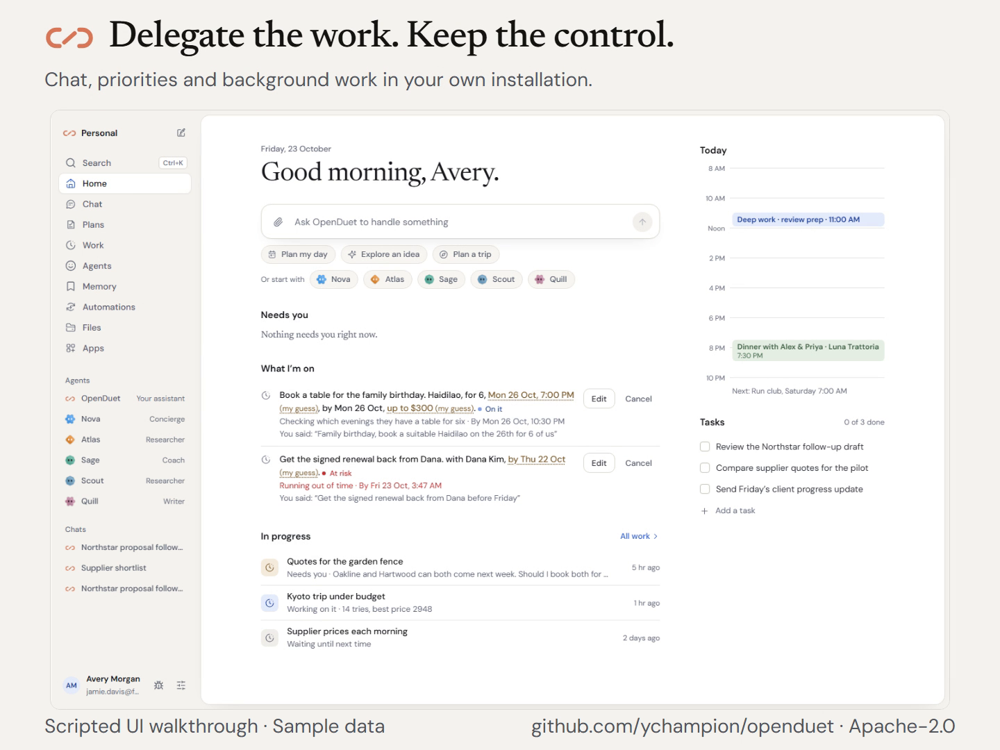](https://github.com/ychampion/openduet/releases/download/v0.2.1/openduet-overview.mp4)

**[Play / download the overview, 29 seconds](https://github.com/ychampion/openduet/releases/download/v0.2.1/openduet-overview.mp4)**

| Time | What appears | Why it matters |
| --- | --- | --- |
| 0–7 s | Home with tasks, priorities and work in progress | One place to start work and return to decisions. |
| 7–14 s | A client follow-up draft | Inspect the full message before authorising a send. |
| 14–21 s | A morning brief and recurring research | Give repeatable work a schedule and inspect its runs. |
| 21–29 s | Model settings | Configure the model for your own installation. |

## Client follow-up

[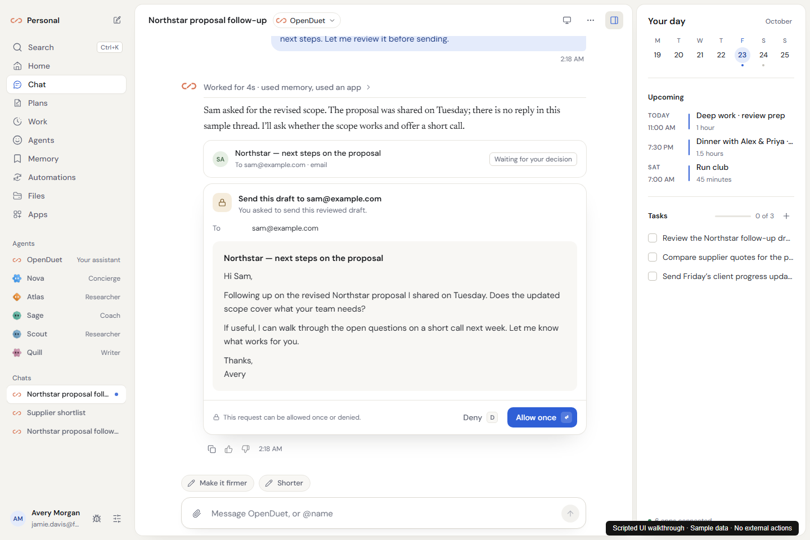](https://github.com/ychampion/openduet/releases/download/v0.2.1/openduet-follow-up.mp4)

**[Play / download the follow-up walkthrough, 20 seconds](https://github.com/ychampion/openduet/releases/download/v0.2.1/openduet-follow-up.mp4)**

The owner asks OpenDuet to read the Northstar proposal thread and draft a
short follow-up. The scripted response reads the sample thread and prepares
a draft to `sam@example.com`. The owner presses **Review and send**, inspects
the recipient, subject and body, then selects **Allow once**. The app displays
the sample send receipt. The fixture delivers no mail.

To use this workflow yourself, connect a real model and mailbox, configure
approvals, and follow [the client follow-up recipe](USE_CASES.md#3-follow-up-without-losing-control-of-your-voice).

## Recurring brief

[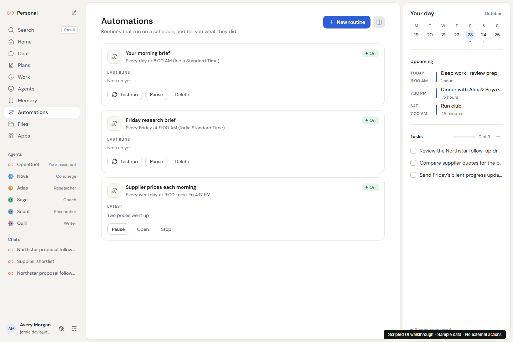](https://github.com/ychampion/openduet/releases/download/v0.2.1/openduet-routines.mp4)

**[Play / download the routines walkthrough, 13 seconds](https://github.com/ychampion/openduet/releases/download/v0.2.1/openduet-routines.mp4)**

The owner opens **Automations**, sees the morning brief and Friday research
schedules, and selects **Test run**. A sample brief appears in the run history.
The owner opens **New routine** to inspect its instruction and schedule fields.
The recording does not demonstrate a real wall-clock wake or live data fetch;
the release checks cover background execution separately.

Use [the daily brief recipe](USE_CASES.md#2-begin-the-day-with-a-useful-brief)
and test it against your own connected sources before relying on it.

## More of the application

| Inspect memory | Connect your tools |
| --- | --- |
| 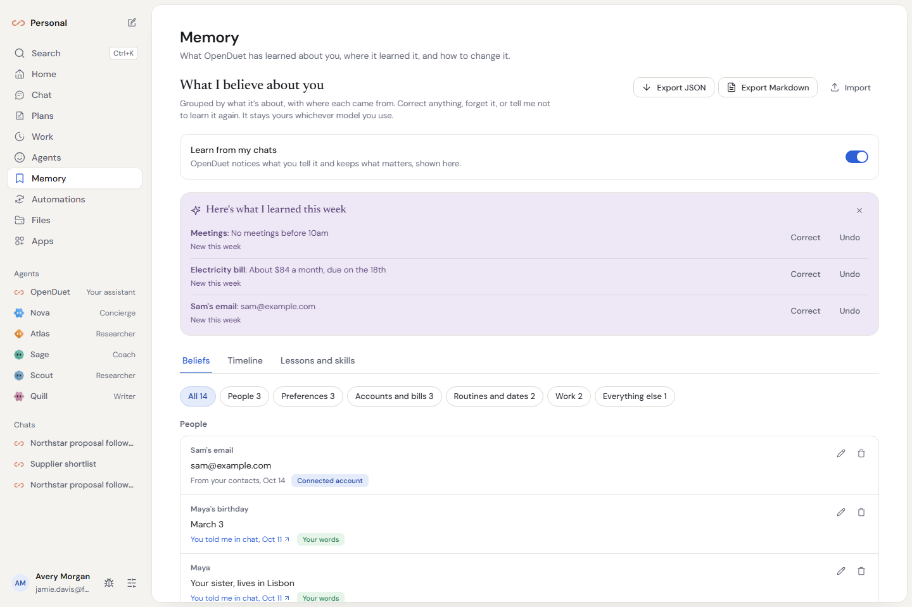 | 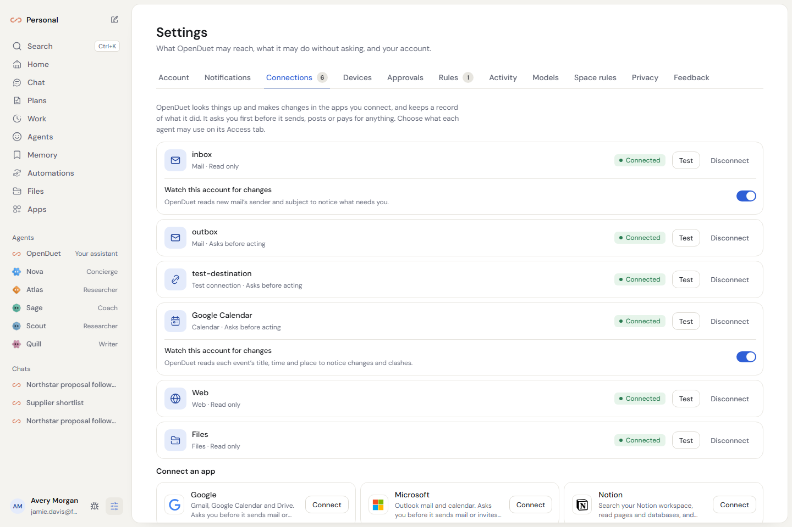 |

| Plan the next step | Select your model |
| --- | --- |
| 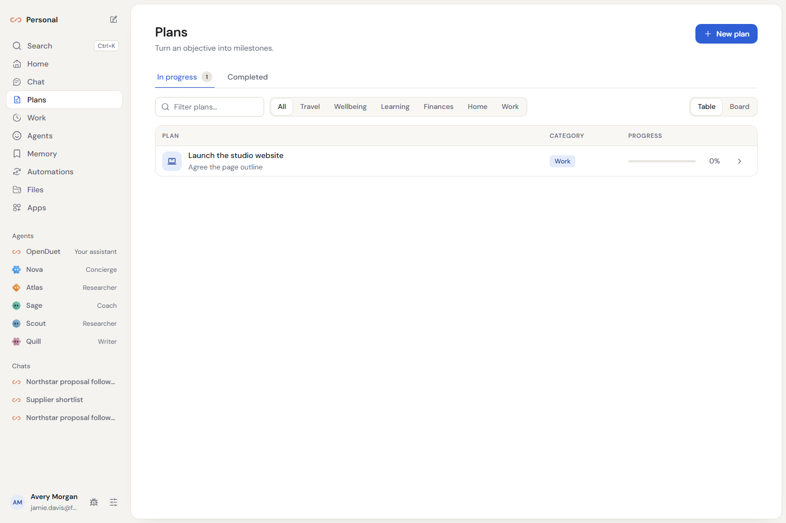 | 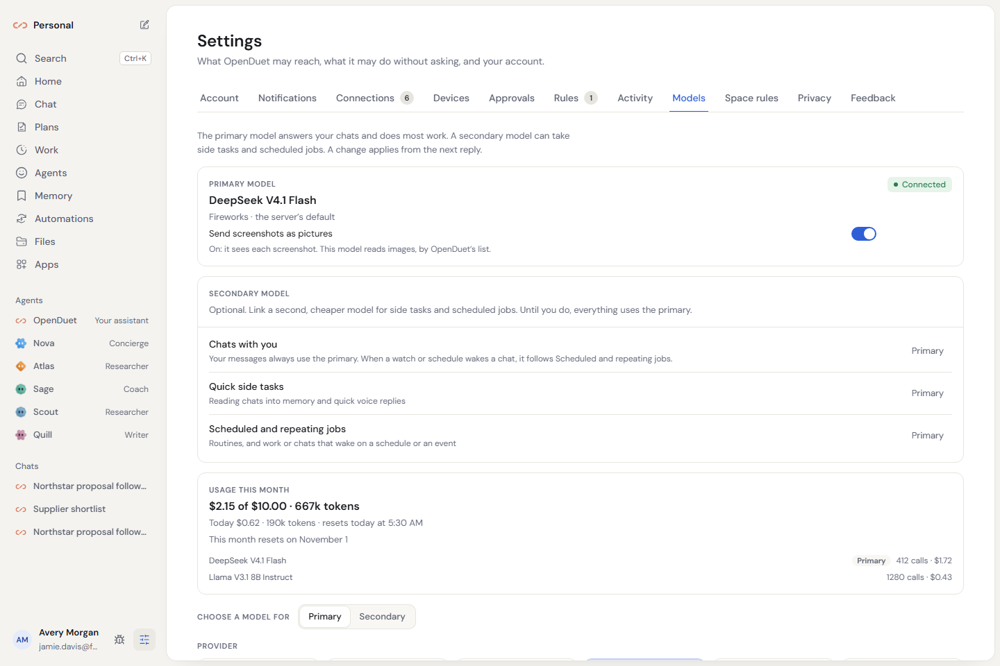 |

| Dark appearance | Phone layout |
| --- | --- |
| 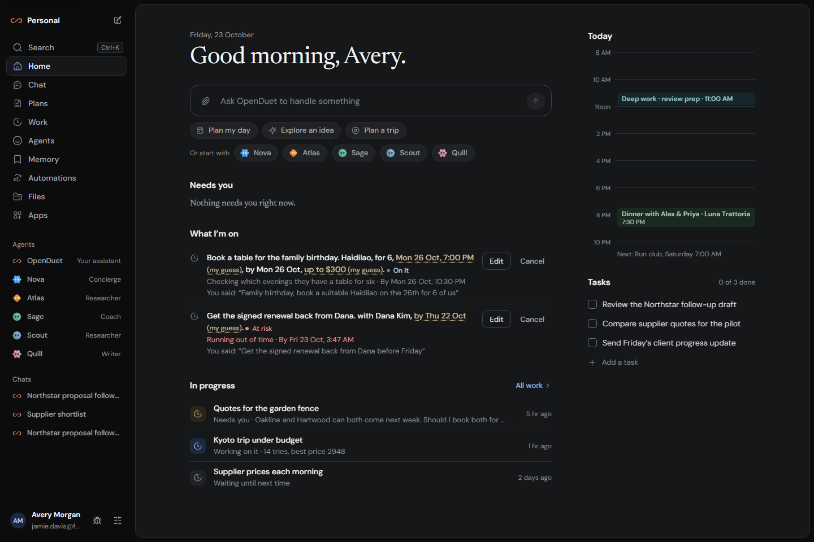 | 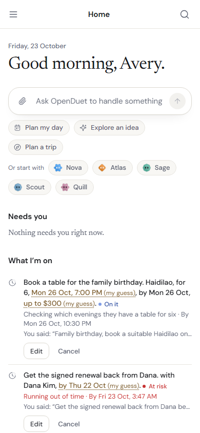 |

Phone access uses the responsive web app / PWA. Screens show configured sample
features; an actual installation requires its own model, accounts and workers.
See [asset provenance and reproduction](media/README.md).

</details>
